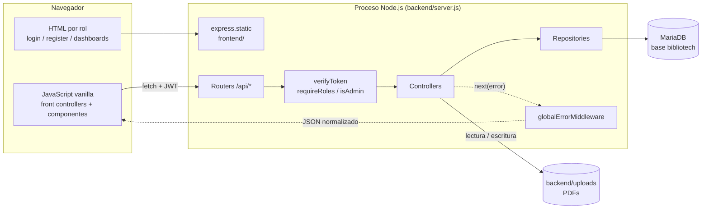
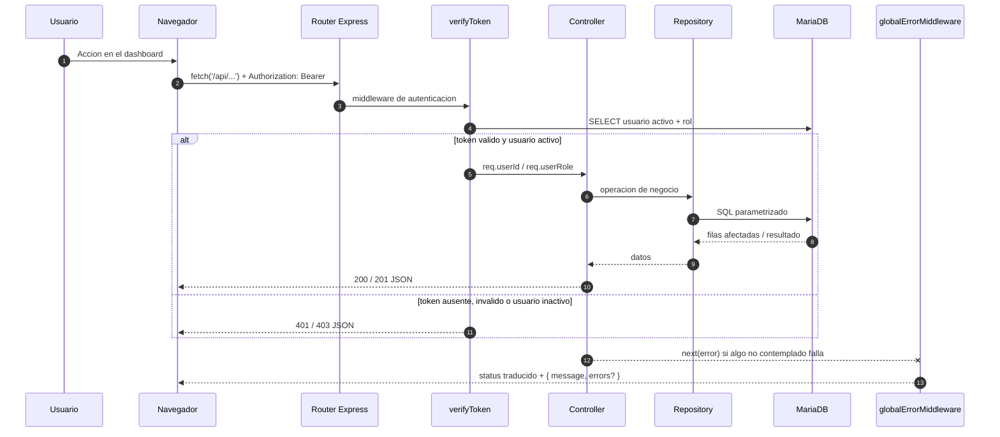
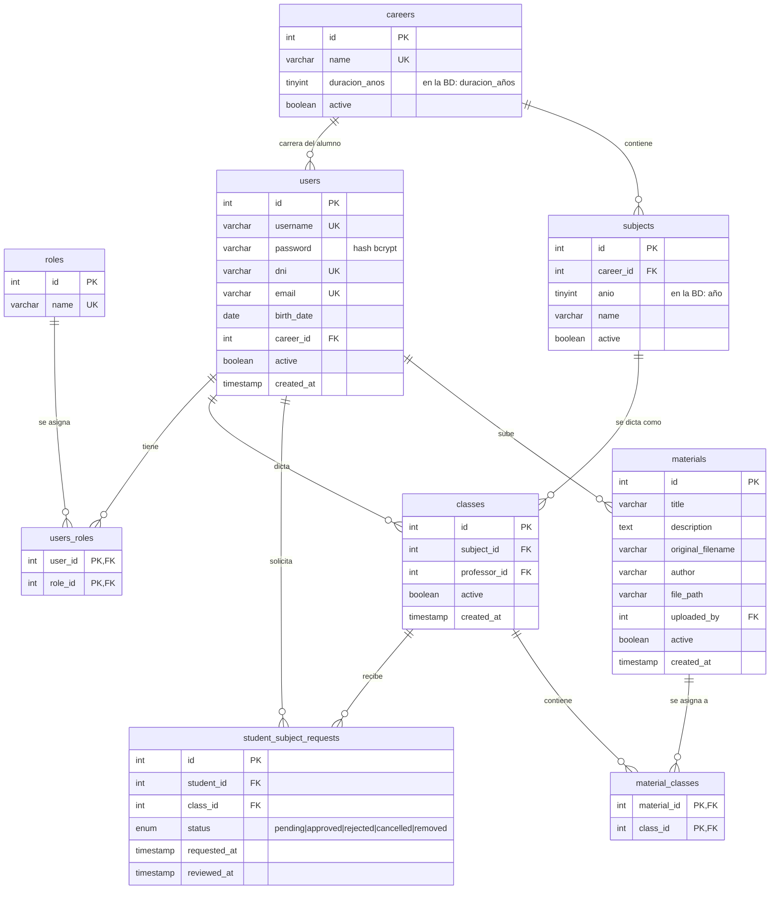
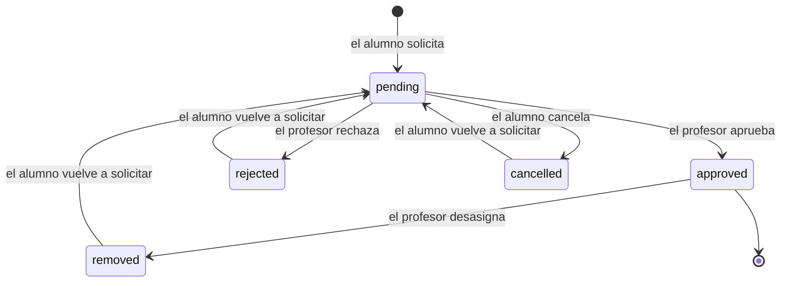
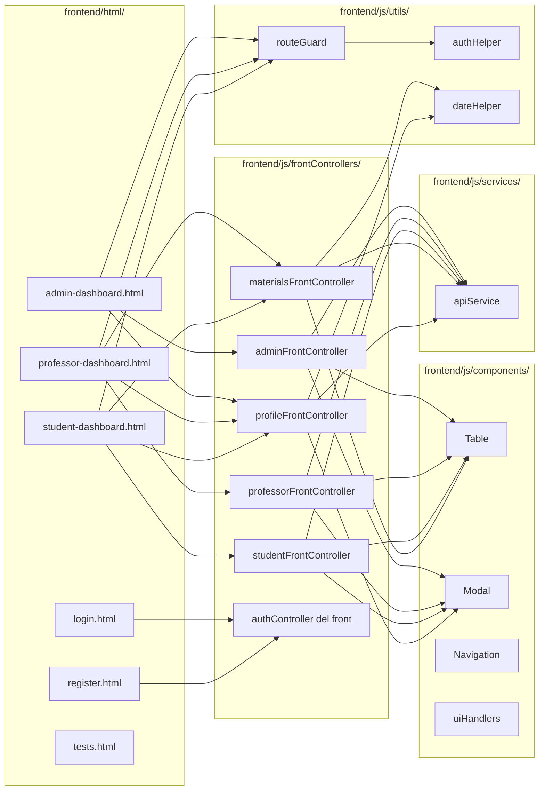

# Arquitectura de Bibliotech

Documento tecnico complementario al [README](../README.md) y al [SRS](SRS.md).
Describe **como esta construido** el sistema: sus capas, sus flujos y las
decisiones que sostienen el diseno.

---

## 1. Resumen

Bibliotech es una aplicacion web **monolitica de dos capas** servida por un
unico proceso Node.js:

- **Frontend**: HTML estatico + JavaScript vanilla + W3.CSS. Sin frameworks,
  sin bundler y sin paso de build.
- **Backend**: Express en capas (`routes -> middleware -> controllers ->
  repositories -> MariaDB`).
- **Persistencia**: MariaDB con SQL parametrizado. No hay ORM.
- **Archivos**: los PDFs viven fuera del arbol publico, en `backend/uploads/`,
  y solo se sirven a traves de endpoints autenticados.

El navegador y la API comparten el mismo origen: el frontend usa una URL
**relativa** (`/api`). `cors()` esta habilitado para permitir clientes externos
(por ejemplo, pruebas con `curl` o Postman), pero no es necesario en el flujo
normal de la aplicacion.

---

## 2. Vista de contenedores

**Credenciales de base de datos en dos niveles:**

| Uso | Usuario | Permisos |
|---|---|---|
| Aplicacion en ejecucion | `DB_USER` (`bibliotech`) | `SELECT, INSERT, UPDATE, DELETE, EXECUTE` |
| Bootstrap y diagnostico (`npm run db:setup` / `db:check`) | `DB_ROOT_USER` (`root`) | administracion total |

La aplicacion nunca corre como root (Principio de Menor Privilegio).

---

## 3. Capas del backend

### 3.1 Responsabilidades

| Capa | Carpeta | Hace | No hace |
|---|---|---|---|
| Rutas | `routes/` | Declara endpoints y aplica middlewares de autenticacion/rol | Logica de negocio ni SQL |
| Middlewares | `middleware/` | `verifyToken`, `requireRoles`, `isAdmin`, manejo global de errores | Acceder a tablas de negocio |
| Controladores | `controllers/` | Valida la entrada, decide el status HTTP, arma la respuesta | Escribir SQL |
| Repositorios | `repositories/` | Todo el SQL parametrizado y las transacciones | Conocer `req`/`res` |
| Validadores | `validators/` | Reglas de formato (`RequiredFields`, `Email`, `Password`) | Autorizacion ni permisos |
| Configuracion | `config/` | Pool de conexiones, Multer, esquema `init.sql` | Logica de negocio |
| Utilidades | `utils/` | `fileHelper`, `i18n` (mensajes `es`/`en`), scripts de BD | Estado de la aplicacion |

**Regla dura:** no hay SQL en controladores ni en el frontend. Si un endpoint
necesita datos nuevos, se agrega un metodo al repositorio.

### 3.2 Ciclo de vida de una peticion autenticada

`verifyToken` **siempre** revalida contra la base que el usuario siga activo y
que el rol del token coincida con el rol actual: un usuario desactivado no puede
seguir operando con un JWT vigente.

### 3.3 Orden de middlewares en `server.js`

El orden importa y no es arbitrario:

1. Debug de metodo/ruta por consola.
2. `cors`, `express.json`, `express.urlencoded` y `languageMiddleware` (resuelve `req.language`).
3. Rutas de la API (`/api/auth`, `/api/admin`, `/api/academic`, `/api/materials`). Las rutas publicas de autenticacion aplican `createRateLimiter` (login/registro) antes del controller.
4. **Fallback JSON** para `/api/*` desconocido (evita que un endpoint mal
   escrito devuelva el HTML de login).
5. `express.static(frontend/)` — sirve CSS, JS e imagenes.
6. `viewRoutes` (normal) **o** `testsRoutes` (con `NODE_ENV=testing`).
7. `globalErrorMiddleware` — **estrictamente el ultimo**.

El paso 4 es la razon por la que un `GET /api/no-existe` responde JSON y no la
pagina de login.

---

## 4. Superficie de la API

Todas las rutas devuelven JSON. Los errores tienen la forma
`{ message, errors? }`, donde `errors[]` es la lista de
`{ field, message }` que consume `apiService.formatErrors()`.

### Autenticacion — `/api/auth`

| Metodo | Ruta | Rol | Descripcion |
|---|---|---|---|
| POST | `/register` | publico | Alta de alumno |
| GET | `/careers` | publico | Carreras activas para el registro |
| POST | `/login` | publico | Devuelve JWT, rol e id |
| GET | `/me` | autenticado | Datos completos del usuario del token |
| PATCH | `/profile` | autenticado | Edita nombre, apellido, email y telefono |
| PATCH | `/password` | autenticado | Cambia la contrasena verificando la actual |

### Academico — `/api/academic`

| Metodo | Ruta | Rol | Descripcion |
|---|---|---|---|
| GET | `/catalog` | autenticado | Catalogo de clases activas |
| GET | `/classes` | profesor | Clases propias |
| GET | `/requests` | profesor | Solicitudes de sus clases |
| PATCH | `/requests/:id` | profesor | Aprobar / rechazar / desasignar |
| GET | `/my-requests` | alumno | Solicitudes propias |
| POST | `/requests` | alumno | Solicitar acceso a una clase |
| DELETE | `/requests/:id` | alumno | Cancelar una solicitud pendiente |
| GET | `/my-classes` | alumno | Clases aprobadas |

### Materiales — `/api/materials`

| Metodo | Ruta | Rol | Descripcion |
|---|---|---|---|
| GET | `/` | los 3 | Materiales visibles segun el rol |
| GET | `/:id/view` | los 3 | PDF inline (previo control de acceso) |
| GET | `/:id/download` | los 3 | Descarga como adjunto |
| POST | `/` | admin, profesor | Subida multipart (`pdfFile`) |
| PATCH | `/:id` | admin, profesor | Edicion de metadatos y clases |
| DELETE | `/:id` | admin, profesor | Baja logica + borrado fisico |

### Administracion — `/api/admin`

`router.use(verifyToken, isAdmin)` aplica a **todas** las rutas del router.
Cubre usuarios, carreras, materias, clases y asignaciones. La tabla completa
esta en el [README](../README.md#11-api-principal).

---

## 5. Modelo de datos

Nueve tablas. El script `backend/config/init.sql` es la unica fuente de verdad
(incluye `DROP DATABASE`: es destructivo).

### Notas del modelo

- **La clase es el vinculo historico.** Cambiar al profesor de una materia no
  modifica la clase existente: se crea una clase nueva. Asi no se rompe el
  historial de materiales ni de solicitudes.
- **`año` y `duracion_años`** son atributos, no tablas. No existe una tabla de
  años academicos.
- **Materiales y clases**: relacion N a N (`material_classes`). Un PDF puede
  pertenecer a varias clases y se muestra repetido en cada una.
- **Solicitudes**: un alumno tiene a lo sumo una fila por clase
  (`UNIQUE (student_id, class_id)`); volver a solicitar reutiliza la fila.

---

## 6. Ciclo de vida de una solicitud

Reglas efectivas en el repositorio:

- `requestClass`: si ya existe una solicitud `pending` o `approved` la devuelve
  sin cambios (idempotente). Si estaba `cancelled`, `rejected` o `removed`, la
  reactiva a `pending`.
- `cancelRequest` (alumno): solo desde `pending`.
- `updateRequest` (profesor): acepta `approved`, `rejected` o `removed`, y solo
  sobre solicitudes de sus propias clases que esten en `pending` o `approved`.

---

## 7. Frontend

### Reglas del frontend

- **Un front controller por dashboard.** `materialsFrontController.js` es
  compartido por alumno y profesor y se discrimina por la existencia del
  formulario de subida (`#uploadForm`). `profileFrontController.js` es
  compartido por los tres paneles y dibuja la pestaña `Perfil`.
- **Todas las grillas usan `Table`.** No se crean tablas a mano ni handlers
  propios de orden/filtro.
- **Cero `innerHTML`.** Las columnas `html:true` pasan por
  `Table.sanitizeHtml()`; el texto se interpola con `Table.escapeHtml()`.
- **Fechas**: siempre `DateHelper`, nunca `toLocaleString` suelto.
- **`API_URL` relativa** (`/api`): el frontend se sirve desde el mismo Express.
- **Navegacion por pestañas** con carga perezosa (`navigation.js`): cada
  dashboard registra sus callbacks y las pestañas se cargan la primera vez que
  se abren.

---

## 8. Seguridad

| Amenaza | Control |
|---|---|
| Acceso sin sesion | `verifyToken` en todos los routers de datos |
| Escalamiento de privilegios | `requireRoles(...)` por endpoint; `isAdmin` en todo `/api/admin` |
| Token de usuario desactivado | `verifyToken` revalida `active` y el rol en cada request |
| Sesion que sobrevive a un reinicio | Cada JWT lleva el `bootId` del proceso; `verifyToken` rechaza los de arranques anteriores |
| Inyeccion SQL | Consultas parametrizadas (`?`) en todos los repositorios |
| XSS almacenado | Sanitizador con lista blanca en `Table`; cero `innerHTML` |
| Path traversal | `fileHelper.resolveUploadPath()` bloquea `..` y rutas fuera de `uploads/` |
| PDFs publicos | `uploads/` **no** se sirve con `express.static`; solo por endpoints con JWT |
| Fuerza bruta de hash | bcrypt con costo 12 |
| Contrasena nueva mal confirmada | `PasswordConfirmation` valida `password`/`confirmPassword` en registro y `newPassword`/`confirmPassword` en el cambio |
| Cambio de contrasena sin la clave actual | `PATCH /api/auth/password` compara `currentPassword` contra el hash y rechaza reutilizar la misma clave |
| Fuerza bruta de credenciales | Rate limit en memoria: login 5 fallos/15 min por IP+usuario; registro 10/hora por IP |
| Enumeracion de usuarios | El login compara siempre contra un hash bcrypt dummy, exista o no el usuario |
| Contrasenas de mas de 72 bytes | Se rechazan con `400`; no se truncan en silencio |
| Fuga de detalles internos | `globalErrorMiddleware` oculta `stack`/`error` fuera de `development` |
| Exceso de privilegios en BD | usuario `bibliotech` sin `DROP`/`ALTER` |

---

## 9. Decisiones de arquitectura

| Decision | Alternativa descartada | Motivo |
|---|---|---|
| Vanilla JS + W3.CSS | React/Vue + build | Requisito de la catedra: sin toolchain ni dependencias de frontend |
| SQL en repositorios | ORM (Sequelize) | Control explicito del esquema y de las consultas; menos dependencias |
| SQL parametrizado | Stored procedures | El proyecto modelo usaba SP; se mantiene el SQL en el repo por mantenibilidad y portabilidad |
| JWT en `Authorization` | Cookies de sesion | API sin estado y facil de probar desde el navegador; el `bootId` permite invalidar todas las sesiones al reiniciar |
| Monolito de un proceso | Servicios separados | Escala del proyecto: un solo despliegue, sin infraestructura extra |
| `globalErrorMiddleware` | `try/catch` con 500 en cada controller | Un unico lugar traduce errores tecnicos y evita filtrar detalles |
| Rate limiting en memoria | Redis / `express-rate-limit` | Sin dependencias nuevas; alcanza para una instancia y se reinicia con el servidor |
| Sanitizador en `Table` | Convertir las 11 columnas `html:true` a nodos | 1 archivo en lugar de 4, mismo resultado de seguridad |
| Paginacion en el cliente | Paginacion en el servidor | Simplicidad; el volumen actual no justifica cambios de contrato |

---

## 10. Como extender el sistema

### Agregar un endpoint

1. Metodo en el repositorio con SQL parametrizado (`repositories/`).
2. Handler en el controlador con firma `(req, res, next)` y `next(error)`.
3. Ruta en `routes/` con `verifyToken` + el rol que corresponda.
4. Metodo en `frontend/js/services/apiService.js`.
5. Llamada desde el front controller del panel.
6. Si devuelve filas para una grilla: `Table.render(contenedor, columnas, datos)`.

### Agregar una columna a una tabla

1. `ALTER TABLE` en `init.sql` **y** en la base local (o `npm run db:setup`).
2. `SELECT` del repositorio (con alias explicito).
3. Columna en el front controller (`label`, `field` o `value`, `sortable`...).
4. Si es fecha: `filterable: false` y `DateHelper`.
5. Actualizar README/SRS si cambia el contrato de la API.

### Agregar una tabla

1. `CREATE TABLE` en `init.sql` con sus FKs y `ON DELETE` explicito.
2. Repositorio nuevo o metodo en el existente.
3. Permisos: la app usa `GRANT` global, no hace falta tocar nada.
4. Actualizar el `erDiagram` de este documento y `docs/database-uml.puml`.

---

## 11. Deuda tecnica conocida

- **Frontend monolingue**: la API responde en `es`/`en` (negociado con
  `Accept-Language`), pero la interfaz web esta solo en espanol.
- **Validacion de formato** centralizada solo en el alta de alumnos; carreras,
  materias y materiales validan inline.
- **Paginacion en el cliente**: el JSON completo viaja al navegador.
- **Sin migraciones**: `init.sql` es destructivo; no hay versionado de esquema.
- **`server.js` duplica** la definicion de la carpeta `uploads`
  (`path.join(__dirname, 'uploads')`) en lugar de usar `fileHelper.UPLOAD_ROOT`.
